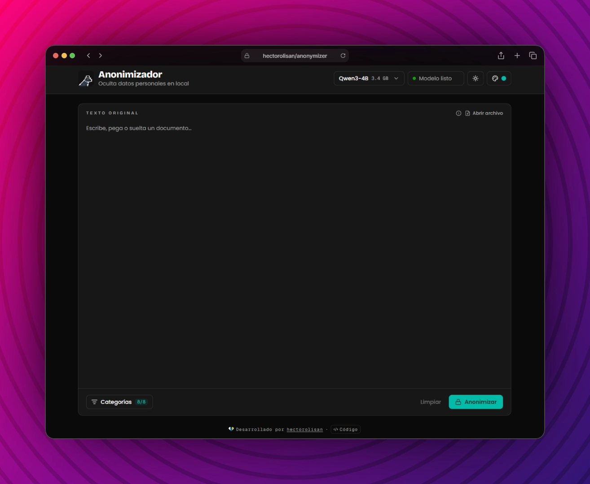

# Anonimizador

Hide sensitive data **before** pasting a text into a cloud AI.
Everything runs **100% in the browser**: regex plus an LLM on the GPU via WebGPU — no server, no API keys, the text never leaves the tab.

- **Next.js 16** — static export (`output: "export"`), no backend.
- **WebLLM** (`@mlc-ai/web-llm`) — in-browser inference on WebGPU, inside a Web Worker, with JSON-schema constrained output.
- **Tailwind CSS 4** (PostCSS) — design tokens, light/dark mode and selectable primary color (teal by default).
- **mammoth**, **JSZip** + **pdfjs-dist** — local text extraction from `.docx`, `.odt` and `.pdf`.
- **Fontsource** — self-hosted fonts.
- **Vitest** + **Testing Library** — unit and component tests.
- **pnpm** — package manager.

> Requires a browser with WebGPU (e.g. recent Chrome or Edge) for names, companies and addresses. The other categories work without it.



## What it detects

| Category         | Detection                                                         | Placeholder     |
| :--------------- | :---------------------------------------------------------------- | :-------------- |
| Personas         | Model                                                             | `[PERSONA_1]`   |
| Empresas         | Model + regex fallback for legal forms (S.L., S.A., S.Coop.…)     | `[EMPRESA_1]`   |
| Emails           | Regex                                                             | `[EMAIL_1]`     |
| Teléfonos        | Regex, Spanish (optional +34/0034) and international `+XX`        | `[TELEFONO_1]`  |
| DNI/NIE          | Regex, dots and dashes allowed                                    | `[DNI_1]`       |
| CIF              | Regex + control digit                                             | `[CIF_1]`       |
| Seguridad Social | Regex + mod-97 control                                            | `[NSS_1]`       |
| Pasaportes       | Regex, number after "pasaporte"                                   | `[PASAPORTE_1]` |
| Importes         | Regex, €/EUR/euros or Spanish thousands format (1.500,00)         | `[IMPORTE_1]`   |
| Cuentas          | Regex, full or partial IBAN and 20-digit CCC                      | `[CUENTA_1]`    |
| Tarjetas         | Regex, 13–19 digits + Luhn                                        | `[TARJETA_1]`   |
| Direcciones      | Model + regex fallback for street type + number                   | `[DIRECCION_1]` |
| Matrículas       | Regex, current format 1234 BCD                                    | `[MATRICULA_1]` |
| Nacimiento       | Regex, dates after "nacido el" / "fecha de nacimiento"            | `[FECHA_1]`     |
| IP               | Regex, IPv4                                                       | `[IP_1]`        |
| URLs             | Regex, http(s) and www                                            | `[URL_1]`       |

- The same entity always gets the **same placeholder**.
- A filter dialog with checkboxes chooses **which categories** to anonymize (all on by default).
- After anonymizing only the result is shown, with the placeholder → value map below; it lives **only in the tab**.
- Models: Qwen3 4B (default), Llama 3.2 3B and Gemma 4 E2B, loaded on start and cached by the browser.
- A **Content-Security-Policy** `<meta>` only lets the page talk to itself and the model hosts.
- Installable **PWA** (`manifest.webmanifest` + `public/sw.js`): works offline once the model is downloaded.

## Project Structure

```
/
├── public/
│   └── cover.webp
├── src/
│   ├── assets/
│   │   └── logo.svg                # Header logo (pixel mascot)
│   ├── app/
│   │   ├── apple-icon.png
│   │   ├── favicon.ico
│   │   ├── globals.css             # Tailwind + design tokens
│   │   ├── icon.svg                # Pixel mascot favicon
│   │   ├── layout.tsx              # <html>, fonts, theme script + metadata
│   │   └── page.tsx                # Renders <AnonymizerApp />
│   ├── components/
│   │   ├── anonymizer-app.tsx      # Header, input, result and layout
│   │   ├── category-filter.tsx     # Filter button + categories dialog
│   │   ├── file-info.tsx           # Accepted formats + size limit popover
│   │   ├── credit.tsx              # Footer credit
│   │   ├── mapping-table.tsx       # Placeholder → original table
│   │   ├── model-status.tsx        # Model selector + WebGPU/loading status
│   │   ├── theme-controls.tsx      # Light/dark + primary color picker
│   │   └── ui.tsx                  # Placeholder chip, copy button, notices
│   ├── hooks/
│   │   └── use-anonymizer.ts       # Model loading + anonymize state
│   └── lib/
│       ├── anonymize.ts            # Regex rules, prompt, dedup, chunks
│       ├── engine.ts               # Model list + WebLLM engine + entity extraction
│       ├── engine.worker.ts        # Web Worker running the engine
│       ├── extract.ts              # .txt / .md / .csv / .json / .docx / .odt / .pdf → text
│       ├── theme.ts                # Theme + primary color persistence
│       └── utils.ts
├── .github/workflows/deploy.yml    # Lint + test + GitHub Pages
├── scripts/
│   └── generate-test-files.mjs     # Fictitious test documents → ./test-files
├── AGENTS.md
├── LICENSE
├── next.config.ts
├── postcss.config.mjs
├── package.json
└── README.md
```

## Available Scripts

| Command        | Action                                                  |
| :------------- | :------------------------------------------------------ |
| `pnpm install` | Install all dependencies                                |
| `pnpm dev`     | Start dev server at `localhost:3000`                    |
| `pnpm build`   | Build static site into `./out/`, deployable on any host |
| `pnpm lint`    | Run ESLint                                              |
| `pnpm test`    | Run Vitest                                              |
| `pnpm test-files` | Generate fictitious test documents in `./test-files/` |

> You can also use `npm` or `bun` if you prefer.

---

Developed by Héctor Olivares Sánchez.
Inspired by [anonimizador](https://github.com/beailabs/anonimizador) by beailabs.
